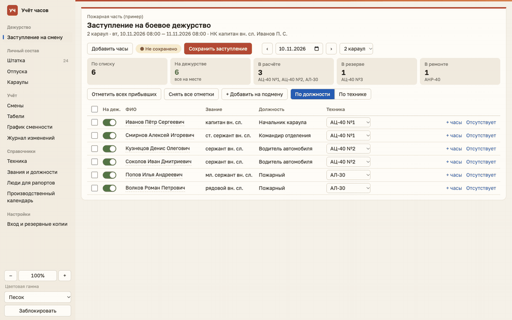
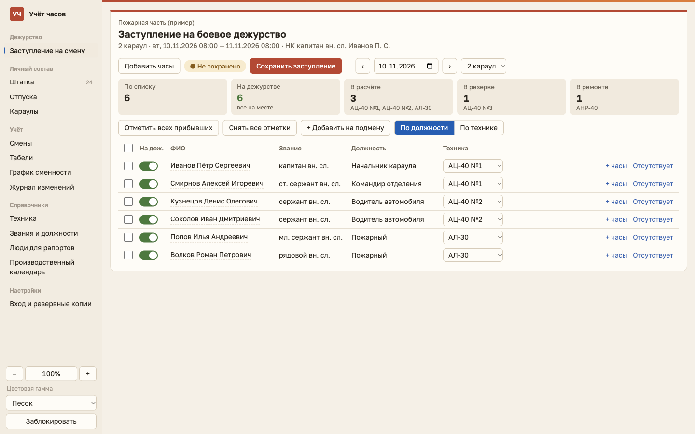
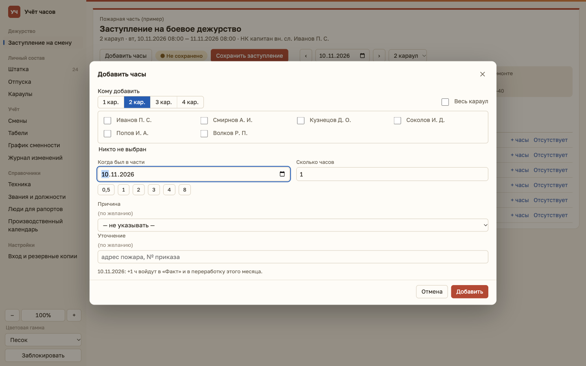
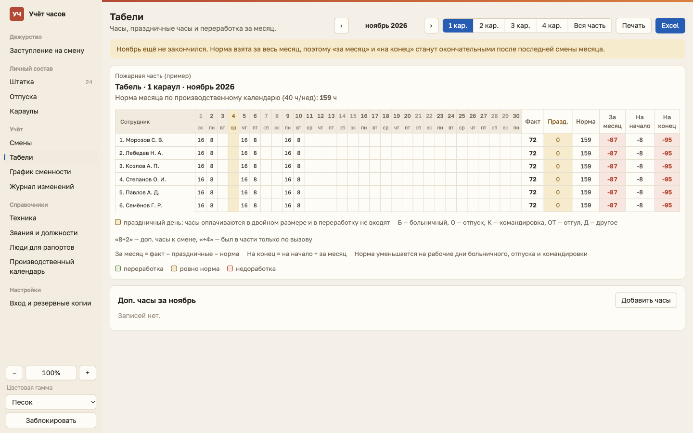
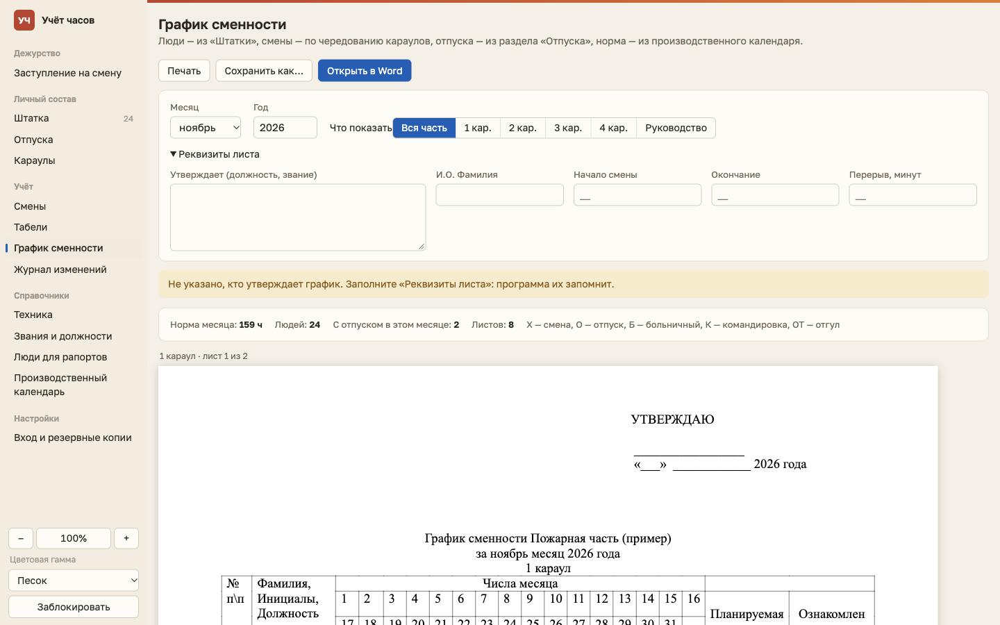
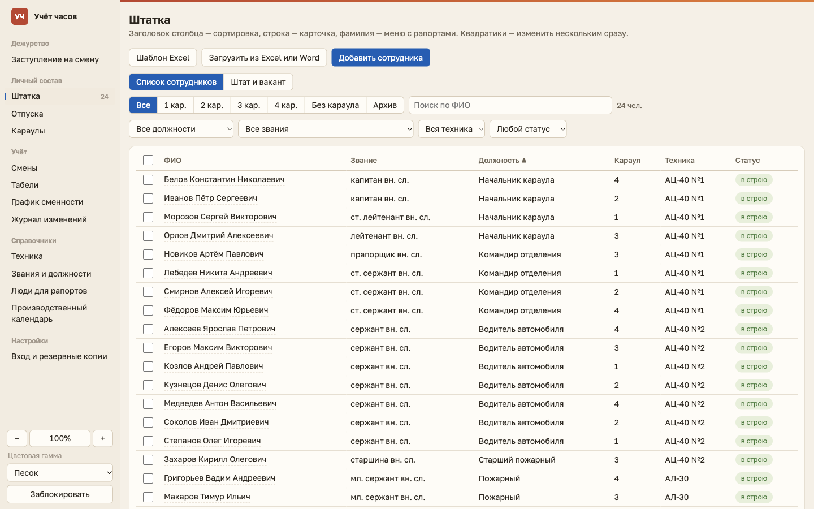
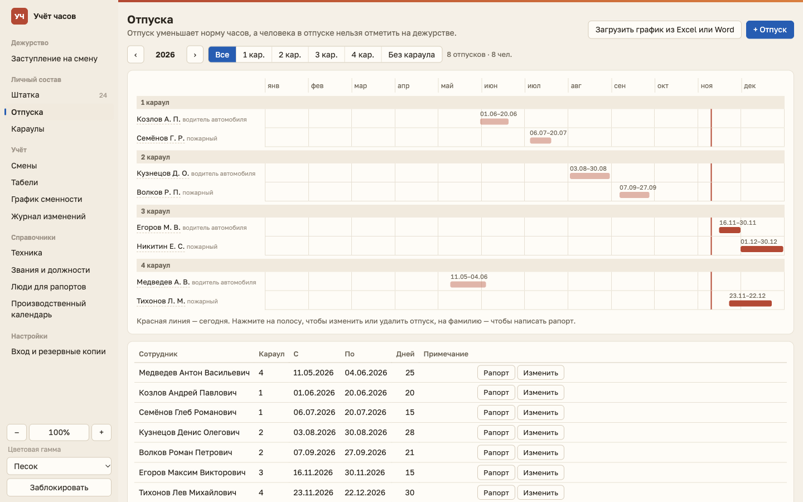
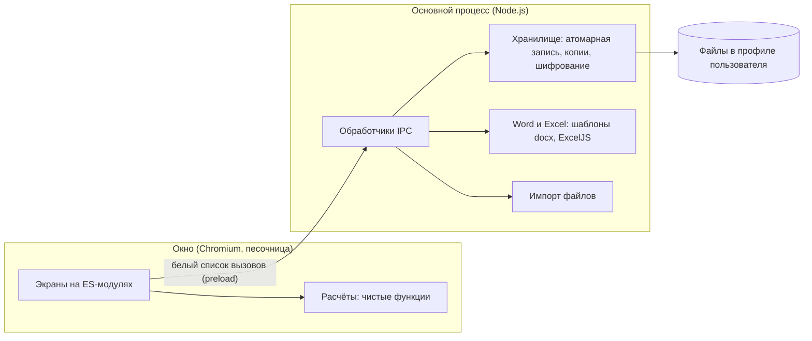

# Учёт часов

Настольная программа для Windows, которая ведёт учёт отработанных часов и переработки в пожарной охране с графиком «сутки через трое». Она заменяет ручные таблицы: начальник отмечает, кто заступил на смену, а табель, переработка, график сменности и рапорты в Word получаются автоматически.

> **Неофициальная тестовая программа.** Это личная разработка для удобства учёта. Она не является официальным продуктом МЧС России, не связана с ведомством, не утверждена им и не заменяет официальные системы и документы. Все люди и данные на скриншотах вымышлены.

Программа проходит опытную эксплуатацию у одного пользователя и работает без интернета. Здесь опубликованы описание, скриншоты и модуль расчётов с тестами. Демо-версию с вымышленными данными могу прислать по запросу через контакты в профиле GitHub.

*An unofficial test project: a Windows desktop app (Electron) for tracking shift hours and overtime in fire protection. It is a personal tool made for convenience and is not an official product of, or affiliated with, EMERCOM of Russia. This repository is a showcase: description, screenshots with fictional data, and the tested calculation module. A demo installer with fictional data is available on request.*



## Что умеет

- **Заступление на смену:** отметка людей, техника, подмены, больничные и отпуска. Отсутствующего нельзя случайно поставить на дежурство.
- **Табель:** раскладка суток по календарным дням, ночные и праздничные часы, норма по производственному календарю, накопительная переработка, выгрузка в Excel.
- **Дополнительные часы:** сразу нескольким людям из разных караулов, с причиной и записью в журнал.
- **График сменности:** листы по караулам с учётом отпусков, печать и файл Word.
- **Рапорты:** шесть видов с автоматическим склонением должности, звания и фамилии.
- **Штат и вакансии:** места по штату, кто на них назначен и где вакант.
- **Импорт:** личный состав и график отпусков из Excel и Word.
- **Работа без сети:** вход по паролю, автоблокировка, ежедневные копии, зашифрованная копия для переноса.

| Заступление | Дополнительные часы |
| --- | --- |
|  |  |
| **Табель** | **График сменности** |
|  |  |
| **Штатка** | **Отпуска** |
|  |  |

## Устройство



**Стек:** Electron, JavaScript (ES-модули, без фреймворка), ExcelJS, JSZip, `node:test`, Playwright, electron-builder (установщик NSIS).

**Решения, о которых могу рассказать подробнее:**

- Расчёты отделены от интерфейса и не зависят от Electron, поэтому покрыты быстрыми тестами. Смена 08:00–08:00 раскладывается по двум календарным дням и учитывает ночные часы.
- Документы Word заполняются из шаблонов, сделанных на основе настоящих бланков, поэтому сохраняется оформление бланка.
- Страницы графика разбиваются измерением реальной высоты строк, чтобы лист A4 не переполнялся.
- Запись базы атомарная: при отключении питания остаётся целая предыдущая версия.
- База не привязана к версии программы: миграции по номеру версии проверены установкой поверх на копиях.

## Безопасность

Перед публикацией программа прошла проверку по коду. В ней работают такие меры:

- Окно изолировано: `contextIsolation`, `sandbox`, запрет Node.js, запрет новых окон и переходов, строгая политика содержимого (CSP).
- Окно получает только перечисленные функции, а доступ к данным проверяется в основном процессе.
- Пароль хранится как хеш scrypt со случайной солью, сравнение идёт за постоянное время.
- Копия для переноса шифруется AES-256-GCM, ключ получается из пароля через scrypt.
- Весь пользовательский текст экранируется при выводе в HTML и XML, загружаемые копии базы проверяются.

Что нашла проверка и как закрыто:

| Проблема | Решение |
| --- | --- |
| Старые `.doc` и `.xls` открывались через Office из программы, а там макросы по умолчанию не блокируются | Макросы запрещаются до открытия файла (`AutomationSecurity`) |
| Имя файла могло стать частью команды PowerShell | Пути передаются через переменные окружения, а не текстом команды |
| Символы вроде `$'` в тексте могли повредить документ Word | Подстановка за один проход функцией замены |
| Служебные поля чужой копии базы выводились без проверки | Проверка при восстановлении и экранирование при выводе |

Известное ограничение: база на диске пока не зашифрована, пароль защищает вход в программу. Шифрование базы запланировано следующим шагом.

## Запуск тестов

В репозитории есть модуль расчётов (`src/calc.js`) и его тесты. Зависимости не нужны, достаточно Node.js 20 или новее:

```bash
npm test
```

## Лицензия

Все права защищены, см. [LICENSE](LICENSE). Материалы опубликованы только для ознакомления.
